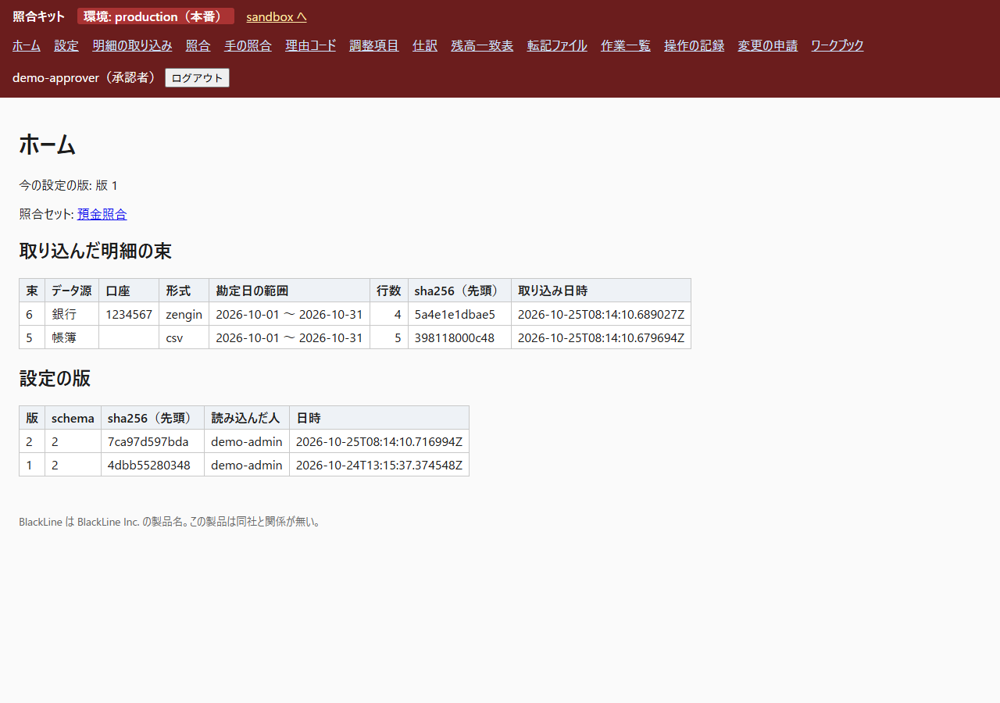
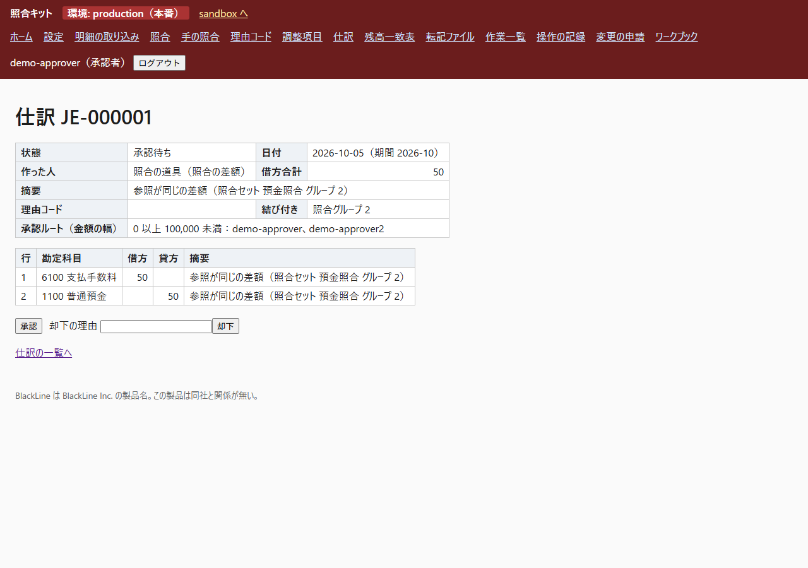

# close-matching-kit

**In plain words.** At the end of each month a company has to check that its bank account and its own books agree, and to
record what explains the difference (a bank fee, interest, a payment still on its way). This tool does that checking on one
PC: it pairs the bank statement with the books, shows what does not pair, lets one person prepare the correcting entry
and a *different* person approve it, and then shows on one page whether bank and books agree. It is for the people who do
the month-end close (preparers, approvers, administrators) and for auditors, who can only read. With the sample company in
`samples/` the difference ends at 0 (1,503,987 on both sides). The screens are in Japanese.

A small tool for month-end bank reconciliation and the close around it. A settings workbook (Excel) defines the data
sources, the matching rules, the reason codes, who approves what, and the task list. Bank statements (Zengin fixed length,
camt.052 XML, CSV) and a ledger CSV are imported with checks; the rules are applied in order; what is not clean is shown
to a person. A pair inside the tolerance is matched at once and, when its rule names an account for the difference, the
tool drafts the **journal** of the difference itself; any other difference becomes a **journal draft** or a **timing item**
through a reason code. A *different* person approves it (the maker of the tool's draft is the tool's own user); the **period-end statement** shows adjusted bank balance against adjusted book balance and calls what is
left the unidentified difference; approved journals leave as a **posting file**; a **task list** with due dates counted
from the period end ties the close together, and a task whose figures stop holding goes back. The screens are in
Japanese. It runs on one laptop: no paid service, no network call, no LLM.

"BlackLine" is a product name of BlackLine Inc. This repository has no relation to that company and is not the same
product. The terms of its public material (match set, pass rule, data source, reason code, task, journal) are used with
their Japanese names, and where a meaning differs the ADRs say so. What is and is not built: `docs/adr/0005`.

## How the rules treat the hard cases

Each of these starts from a document of another reconciliation product (`docs/sources.md`, `docs/adr/0003`); where the tool goes further, the text says it is the author's decision:

- **A difference inside the tolerance**: Oracle says that for a one to one match "any amount difference within tolerance is
  automatically created as an external transaction in cash management"; Odoo's model "Invoices/Bills partial match if
  underpaid" reconciles the difference "with the account indicated in the counterpart entries tab", and its payment
  tolerance "is disregarded when an overpayment is received". Neither page describes a journal drafted for a second person.
  That part is the author's decision: if the pass rule has an account in its column 「差額の相手勘定」, the pair is 完了 and
  the tool drafts the journal to that account; another person approves it. A rule without the column keeps the pair in
  差額の処理待ち for a reason code.
- **Duplicates** (Reconify `flag`): rows that share a reference take part in matching and are shown with a mark.
- **More than one possible partner** (Oracle "Ambiguous", NetSuite): never automatic; one candidate holds all the rows.
- **An earlier rule's candidate**: Odoo says "If a record matches with several reconciliation models, the first one in the
  sequence of models is applied", which only says which model applies. That a candidate keeps its rows against later rules
  is the author's decision.
- **Bundles** (Oracle): equal totals only, no amount tolerance; the date is compared only when 勘定日 is a bundle key.
- **The range of days from the period end** (Oracle Close Manager) is a setting of the workbook: -20 to 40 when empty.

## Why it was built, how, and what came out

**Why.** The month-end bank reconciliation, the close task list and journal approval are what paid close software sells
(BlackLine's Transaction Matching, Task Management and Journal Entry). The question was whether their core can be built
from public documents alone, on one laptop and at no cost, together with the documents a deployment needs: the settings
workbook, test cases, a test summary report, manuals and a question log.

**How.** The rules follow the public documents of BlackLine and of other reconciliation products (Oracle, Odoo, NetSuite,
Reconify) and two control standards (the Financial Services Agency's and NIST's); where none of them speaks, the rule is
marked as the author's decision (`docs/sources.md`). Correctness is measured on public bank transactions with known true
pairs (the Splink data): the rules were written from the first half only, the target was written down before the second
half was run once (`docs/validation/targets.md`, `splink_rules.md`). 450 tests run without a network, and 36 places in the
code were broken one at a time to see that a test goes red (`docs/validation/mutations.md`). The three hard decisions of
the matching, with the options compared and where they are in the code: ADR 0003.

**What came out.** On the second half, 5,541 of the 5,564 automatic pairs are correct (precision 0.9959; 0.9956 on the
first half). Only a quarter of the true pairs become automatic (recall 0.2470; 0.5752 with the candidates a person
confirms): about 75 percent of the true pairs differ in amount and the data has no reference column, so a rule that
compares for equality cannot link them (`docs/validation/results.md`). The sample company reaches a difference of 0. Every value
or rule taken from a document quotes the sentence it rests on, and what no document decides is listed as the author's
decision (`docs/sources.md`).

## Built with

Python 3.12 (tried with 3.12.10 on Windows 11). Web screens: FastAPI (Starlette, uvicorn) and Jinja2 templates. Data: SQLite
from the standard library, with append-only logs enforced by triggers. The settings workbook is read with openpyxl; Zengin,
camt.052 and CSV statements are read with the standard library. Tests: pytest. 28 packages in all, pinned with hashes
(`docs/adr/0001`). No paid service, no network call at run time, no LLM.

## Screens

The sample company at the production environment, as the approver `demo-approver` sees it (more in
`docs/deliverables/images/` and in the manuals):






## Start (Windows, from the repository root)

```
.venv\Scripts\python -m close_kit serve
```

It listens on `http://127.0.0.1:8765`. Only that host and `localhost` are accepted.
The first time, create the demo users (random passwords go to `var/demo_users.txt`, which git ignores). The command can be
run again: it only adds users that are missing (six users: `demo-admin`, `demo-admin2`, `demo-maker`,
`demo-approver`, `demo-approver2`, `demo-auditor`):

```
.venv\Scripts\python -m close_kit seed-demo
```

Users with your own name and roles (the password is typed in, never on the command line):

```
.venv\Scripts\python -m close_kit adduser <name> --roles 作成者,承認者
```

The operation log records who made a user (the action `user_create`; the detail names the person logged in to the PC).

Roles: 作成者 (maker), 承認者 (approver), 管理者 (administrator), 監査人 (auditor, read only). What each may do is the table in
`close_kit/roles.py`; every operation is checked on the server, not only hidden on the screen. Some operations also
need the right *person*: the approver named for the amount, the preparer or reviewer named in a task, and never the
person who made the thing being approved.

## Setting up the environment (a person types this; the code never installs anything)

```
python -m venv .venv
.venv\Scripts\python -m pip install --no-deps --require-hashes -r requirements.lock.txt
```

28 pinned packages with hashes (`docs/adr/0001`). `pyarrow` is needed only for `tools/convert_splink.py` and lives in a
second environment, `.venv-convert` (`requirements-convert.lock.txt`). The second release added no package.

## Upgrading a database of an earlier release

Starting the server (or any command) migrates `var/close_kit.sqlite3` in place: numbered migrations rebuild the tables
whose CHECK lists change, copy every row with its id, and add the new tables (migration 3 adds the change requests and
only adds; migration 4 rebuilds `journals` so that a journal can have the way-made value 照合の差額). Running it twice changes nothing (`docs/adr/0002`, `docs/adr/0008`). Copy the file first
(`docs/deliverables/manual-admins.md`, 3.6 and 3.7). The settings version stored in an old database has schema 1, so the journal, reason code,
statement, posting and task screens stop with a message until an administrator loads the workbook in version 2.

## Try it with the samples (a made-up company)

`samples/` has made-up files: `sample_workbook.xlsx` (version 2), `ledger_2026-10.csv`, `ledger_2026-11.csv`,
`bank_2026-10_zengin.txt`, `bank_2026-11_zengin.txt`, `journals_import_sample.csv`, and three that must be refused:
`bad_workbook.xlsx`, `bad_bank_balance_mismatch_zengin.txt`, `journals_import_bad.csv`. They are written by
`tools/make_samples.py`. Log in as `demo-admin` (passwords: `var/demo_users.txt`).

1. 「ワークブック」: load `sample_workbook.xlsx`. 「設定」 shows the match set, data sources, pass rules (rule 10 names the
   account 6100 for the difference), approval route and tasks.
2. 「明細の取り込み」: 帳簿 <- `ledger_2026-10.csv`; 銀行 <- `bank_2026-10_zengin.txt`. 「照合」: run it. The pair with a
   difference of 50 (INV-2610-003) is 完了 and the run says that a journal draft was made (支払手数料 50 / 普通預金 50; its
   maker is 照合の道具).
3. As `demo-maker`, open that draft under 「仕訳」 and apply (申請). Under 「理由コード」 attach 受取利息 (R03) to the
   bank-only row of 37, and 未達の入金 (R04) to the ledger row of 70,000 on 10-31 (an adjusting item). (A workbook whose rule
   names no account leaves the pair of 50 in 差額の処理待ち; there the reason code 振込手数料 (R01) makes the same draft.)
4. As `demo-approver`, approve the journals and the adjusting item. The maker cannot, and a person cannot approve what they
   made. A journal of 100,000 or more can only be approved by `demo-approver2` (the approval route).
5. 「残高一致表」 for 2026-10 shows the unidentified difference in red (the payment of 41,000 on 10-29 is not at the bank yet).
   Import `bank_2026-11_zengin.txt` and `ledger_2026-11.csv`, run the matching again: the payment pairs with the
   November statement as a timing item, and the statement for 2026-10 reaches a difference of 0 (1,503,987 on both sides).
6. 「作業一覧」: as `demo-admin` make the tasks of 2026-10; `demo-maker` prepares and `demo-approver` completes them in order.
   「預金の残高一致」 can be completed only while the difference is 0.
7. The posting file is written from **production** only (the sandbox screen says it is for trying things out): see
   "Sandbox, production and change requests" below, then, as `demo-admin` in production, 「転記ファイル」.
   `tools/make_samples.py walk` prints the figures of step 5 without a server.

## Sandbox, production and change requests

Two environments, shown in the band at the top of every screen: **sandbox** (try things) and **production**. The
environment is in the path (`/sandbox/...`, `/production/...`; the paths without a head are the sandbox) and in a hidden
field of every form; the server checks that the two are the same. Loading a workbook makes a version for the sandbox only.
A version reaches production through a **change request** (built on the steps of NIST SP 800-128, the pre-approval among the Financial Services Agency's points for an auditor, who checks the development, procurement or change of a system (not written for a change of settings), and the separate test environment of NIST SP 800-53 CM-4(1); what they do not set -
what the test tries, the requester's confirmation, using the Agency's point for a change of settings, and reading the Agency's "user department and IT department" as
承認者 and 管理者 - are the author's design decisions, `docs/sources.md`): 下書き -> 事前承認待ち -> (the test runs by
itself, on throw-away files, never on the live data) 試験済み -> 結果の承認済み -> 本番に適用済み -> 確認済み. The person who asked
can approve, reject or apply nothing; the result needs one 承認者 and one 管理者 who are two people. A closed period cannot
be opened by a change; a rollback is a request too. Closing a month of production goes through a request. The whole flow,
the form and the trust boundary: `docs/adr/0008-change-requests.md`. How to use it: `docs/deliverables/manual-admins.md`.

Acceptance in the browser (the three things to look at) and the other deliverables - test case specification, test
summary report (its numbers come from pytest by `tools/test_report.py`), the two manuals, the question log, the
feature map: `docs/deliverables/README.md`.

### Where the posting file meets your ledger
A ledger CSV that later contains a posted journal must carry its number (`XBLNR`, for example `JE-000001`) in the column
the data source sheet maps to 参照. Such a row is recognised as the books' own copy of the journal (class 転記済み), leaves
the remainder, and the statement stops adding that journal once the row is inside the book balance.

## What is checked

- `.venv\Scripts\python -m pytest -q` (no network).
- `docs/validation/`: `targets.md` (written before the first run on the test data), `results.md` (second half of the
  Splink data, run once), `splink_rules.md`, `reconify_evals.md`, `mutations.md` (36 places in the code are broken one at a
  time and a test must go red), `metrics.md` (the formulas), `acceptance.md` (what was run against the real server).
- `docs/adr/`: eight decisions in Nygard's form. `docs/deliverables/`: the documents above (Japanese). `docs/sources.md`: where every idea and file came from and its license.

## Layout

```
close_kit/    the product: config.py, db.py, workbook.py, versions.py, formats/, ingest.py, matching.py, matchrun.py,
              manual.py, reasons.py, journals.py, balance.py, posting.py, tasks.py, holidays.py (+ data/syukujitsu.csv),
              changes.py, changeinfo.py, changecheck.py (change requests), envs.py,
              metrics.py, money.py, queries.py, safefile.py, timeutil.py, roles.py, auth.py, audit.py,
              web.py, web_close.py, web_changes.py (+ templates/, static/), __main__.py
tools/        sample builders, Splink converter and runner, Reconify eval runner, mutation runner, test_report.py
tests/        pytest, with Reconify's fixtures in tests/external/reconify/
samples/      made-up input files
docs/         ADRs, sources, validation records, deliverables/ (documents)
```

## Limits (said openly)

- Equality-based matching rules only: low recall on data where amounts or memos differ (`docs/validation/results.md`).
- A candidate of an early rule keeps its rows, so the order of the rules is the order of priority: in the sample workbook the
  three instalments of one invoice are a candidate of the reference rule, and the bundle rule behind it never sees them.
- Two data sources per match set. The login is local (no single sign-on). One level of approval. Foreign currency and
  several company codes are not built. A change request has the Scheduled kind only (no urgent flow); data is not copied
  between the sandbox and production; the posting file is JPY only (multiplier 1).
- **The posting file has not been tried in SAP.** Only the technical field names and limits of SAP's journal upload
  (F2548) were read from its documentation. The heading text of SAP's own template and the date format it expects were
  not available; dates are written as `YYYYMMDD`, which is a guess.
- The statement is built as of the period end. A group whose rows lie on both sides of the period end is left in the
  unidentified difference instead of being guessed.
- The business-day count follows Oracle's Close Manager (day 0 is the base date, day 1 the next working day); the base
  date is the period end. BlackLine's material says business days, calendar days or weekdays can be used but not where
  the count starts. The national holidays table covers
  1955-01-01 to 2027-12-31; a business-day due date that needs a day outside it is not made.
- The camt.052 reader refuses a statement whose balances are 0 at both ends but which has entries (the bank writes 0 for
  restricted users), which also refuses a genuine net-zero day.
- Third-party material: `THIRD_PARTY_NOTICES.md`.

## License

MIT (`LICENSE`) for the code and documents of this repository. Third-party material keeps its own terms:
`THIRD_PARTY_NOTICES.md`.
