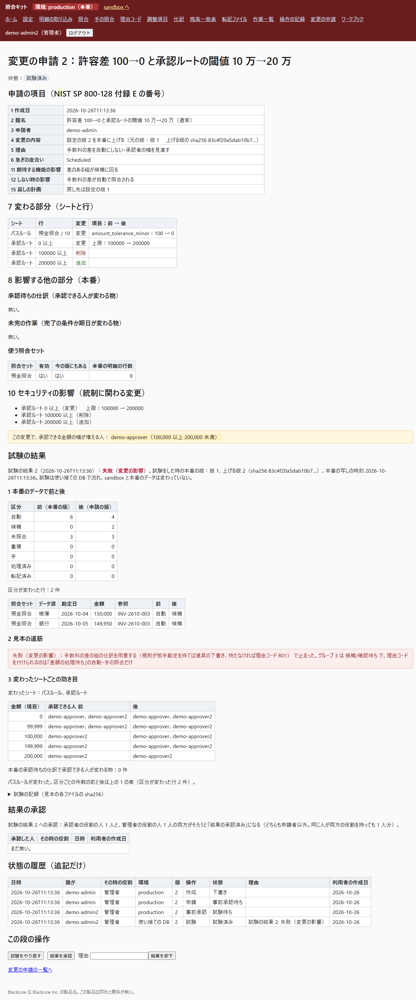
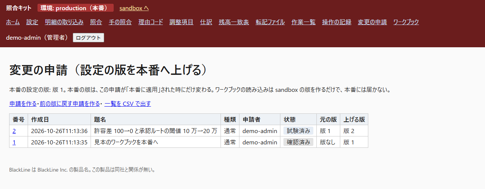

# 操作マニュアル（管理者向け）

様式の出典：CMS Technical Lifecycle Framework "User Manual" の章立て（https://www.cms.gov/Research-Statistics-Data-and-Systems/CMS-Information-Technology/TLC/Downloads/User-Manual.docx ）と、デジタル庁「デジタル社会推進実践ガイドブック DS-120 デジタル・ガバメント推進標準ガイドライン実践ガイドブック」（2024-05-31 https://www.digital.go.jp/assets/contents/node/basic_page/field_ref_resources/e2a06143-ed29-4f1d-9c31-0f06fca67afc/d85eeb55/20240605_resources_standard_guidelines_guideline_05.pdf ）の「システム操作マニュアル（管理者向け）」という種類の分け方。出典：デジタル庁。章立てだけを使い、文は自作した。この repo に合わせて章を変えた（変更：「使い方」を管理者の仕事ごとに分けた）。

管理者以外の役割の使い方は `manual-users.md`。

## 1. はじめに

### 1.1 概要
管理者の仕事は、設定のワークブックを読み込むこと、設定の版を本番に上げる**変更の申請**を回すこと、月を締めること、利用者を作ること、データベースのファイルを守ること。変更の申請の流れは NIST SP 800-128 の構成変更の手順（記録 → 分析 → 試験 → 承認 → 実施 → 確認 → 終了）と、金融庁の内部統制の実施基準（変更の事前の承認・十分な試験・試験の結果の承認・過程の記録）を手本にしている（`docs/adr/0008-change-requests.md`）。金融庁の基準は、会社がシステムを開発・調達・変更する時に監査人が見る点で、設定の変更のために書かれた物ではない。設定の変更に当てはめたのは作者の判断。

### 1.2 読む人
管理者の役割を持つ人。結果の承認だけをする承認者は `manual-users.md` の 3.2.5。

## 2. 始め方

### 2.1 注意
- **本番の設定の版を動かせるのは、変更の申請の「本番に適用」だけ**。「ワークブック」から読み込むと sandbox の版ができるだけで、本番には届かない。本番の「ワークブック」の画面（`/production/workbook`）には読み込みの欄が出ず、直接送っても断られる。
- **申請した本人は、事前承認・却下・結果の承認・却下・適用のどれもできない**。役割をいくつ持っていても同じ。サーバーが確かめるので、画面を通さない送り方でも断られる。
- 本番に版を上げるには、申請者のほかに、管理者 1 人（事前承認と適用）と、結果の承認の 2 人（承認者の役割の人 1 人と管理者の役割の人 1 人）が要る。管理者が 1 人だけの導入先では、本番に版を上げられない（申請者と決める人を分けるための、意図した結果）。
- この PC にログインできる OS の利用者は、データベースのファイルを直接書き換えられる。道具の規則は画面を使う人に対する物で、ファイルの持ち主を止める物ではない（`docs/adr/0008-change-requests.md` の信頼の境目）。

### 2.2 準備
- Python の環境と部品は、README の手順どおりに人が入れる（道具は何も入れない）。
- 利用者を作る（2.3）。見本の利用者 6 人（`demo-admin`・`demo-admin2`・`demo-maker`・`demo-approver`・`demo-approver2`・`demo-auditor`）は `seed-demo`。

### 2.3 利用の権限
`manual-users.md` の 2.3 の表。管理者は、ワークブックの読み込み・変更の申請・作業を作る・転記ファイルを出す・転記を外す・取り込み・照合を実行できる。

### 2.4 開き方
```
.venv\Scripts\python -m close_kit serve
```
`http://127.0.0.1:8765` で待つ。この 2 つの名前（`127.0.0.1` と `localhost`）以外の宛先は受け付けない。

### 2.5 画面の並び
`manual-users.md` の 2.5。管理者に必要なのは「ワークブック」（sandbox）と「変更の申請」。

### 2.6 終わり方
端末で Ctrl+C。

## 3. 使い方

### 3.1 ワークブックを読み込む（sandbox）
1. 帯が「環境: sandbox（試験用）」であることを確かめ、「ワークブック」を開く。
2. 「ワークブック」の欄に `.xlsx` を選んで「読み込む」。
3. 誤りが 1 つでもあれば、全部拒否され、シート名・行・列つきの一覧が出る（何も保存しない）。通ると「読み込んだ。設定の版 N になった。」と出る。これは sandbox の版で、本番には届かない。
4. 締めた期間を開く版（今の sandbox の版で締めてある期間を、締めていないことにする版）は、読み込めない。
5. 版は追記だけで、消えない。ワークブックを読み直すと新しい版ができ、古い版はそのまま残る。

ワークブックの 2 つの設定（どちらも、空なら前の版と同じ動き）：
- 「パスルール」シートの「差額の相手勘定」：種別「自動」・型「1対1」の規則に、勘定コードを書く。その規則で許容差の中の差額のある組は、照合を実行した時に完了になり、道具が預金の勘定とこの勘定の仕訳を下書きに作る。勘定表にあるコードで、預金の勘定は書けない。
- 「説明」シートの「期日の日数の下限」「期日の日数の上限」：作業の「期末からの日数」に書ける範囲（0 を含む）。空なら -20 から 40。

### 3.2 設定の版を本番に上げる（変更の申請）
申請を出す人を A、それ以外の管理者を B、結果を承認する承認者の役割の人を C とする。

1. **A：申請を作る**。「変更の申請」→「申請を作る」。「上げる版」（sandbox に読み込んだ版の番号）、「題名」、「理由」、「期待する機能の影響」、「この変更をしない時の影響」、「戻しの計画」（空なら、申請を出した時の本番の版に戻す）を入れて「下書きを作る」。急ぎの度合いは Scheduled だけ。
2. **A：申請する**。下書きの内容と、自動で出る「7 変わる部分」「8 影響する他の部分」「10 セキュリティの影響」を確かめ、「申請する」を押す（押すと、この 3 つが決まって書き換えられなくなる）。「申請した。事前承認を待つ。」と出る。本番に版がまだ無い時は、前が「版なし」で、差分はワークブックの全部になる。
3. **B：事前承認**。「事前承認」か、理由を入れて「事前却下」を押す。事前承認を押すと、**試験が自動で流れる**（使い捨てのデータベースの上で。sandbox と本番のデータは変わらない）。「事前承認した。試験を流した（結果は下の「試験の結果」）。」と出る。
4. **試験の結果を読む**。次の 3 つが出る。
   - 「1 本番のデータで前と後」：本番の今のデータの写しに、本番の今の版と申請の版で照合を流し直した、区分ごとの件数と、区分が変わった行。本番に明細が無い時は「データなし」、本番に版が無い時は「対象外」。
   - 「2 見本の道筋」：`samples/` の見本を申請の版で流した残高一致表の差、承認した仕訳の数、調整項目の数。申請の版が見本のデータ源と形が違う時は「対象外」。
   - 「3 変わったシートごとの効き目」：承認ルートが変わると、各金額の幅の境目で承認できる人の前と後（本番の承認待ちの仕訳の分も）。作業一覧が変わると、本番の未完の作業の期日と完了の条件の前と後。パスルールが変わると 1 の件数。
   - 変更のせいで途中の手順が止まった時は「失敗（変更の影響）」と出て、どの手順で止まったかが出る。これも結果で、結果の承認に進む（却下するかどうかを決める材料になる）。
   - 道具そのものが止まった時だけは、結果にならず「試験の道具が止まった」と出る。「試験をやり直す」で流し直す。
5. **B と C：結果の承認**。承認者の役割の人（C）が「結果を承認」、管理者の役割の人（B）が「結果を承認」を押す。**2 人そろうと**「結果の承認済み」になる（同じ人が 2 つの役割を持っていても 1 人分）。どちらかが理由を入れて「結果を却下」すると申請は閉じる。「試験をやり直す」と、前の結果への承認は数えなくなる。承認は、その人の画面に出ていた試験の結果の番号と一緒に送られ、画面を開いた後で試験が流し直されていると断られる（読んでいない結果を承認したことにならない）。
6. **B：本番に適用**。「本番に適用」を押す。適用は、**試験をした時の本番の版が今も本番の版である時だけ**通る。先に別の申請が適用されていると、何も変えずに「試験のやり直しに戻した」と出る（先の申請の変更を黙って上書きしない）。上げる版の sha256 は、適用の時に保存してある設定から計算し直して、試験の結果に記録した値と比べる。
7. **A：確認**。本番の画面で、求めた通りに出たかを見て、「確認した」を押す（申請は閉じる）。確かめられない時は、理由を入れて「確認できない」を押す。申請は閉じずに「確認できない」に置かれ、「戻しの申請の下書きを作る」が出る。
8. 申請を取り下げられるのは申請者だけで、適用の前まで。

承認した人ごとの「利用者の作成日」が詳細に出る。**申請より後に作られた利用者**には印が付く。この変更で承認できる金額の幅が増える人が結果の承認者だった時も印が付く（止めはしない）。状態の履歴は、誰が・いつ・その時の役割・環境・版・理由が並び、書き換えも削除もできない。


図 1：変更の申請の詳細（試験の結果）


図 2：変更の申請の一覧

### 3.3 月を締める
本番の月の締め（ワークブックの「会計期間」シートの「締め」の列を「はい」にする）は、**変更の申請を通して行う**。
1. 今の版のワークブックの「締め」を「はい」にして、sandbox に読み込む。
2. 3.2 の手順で本番に上げる。
締めた期間を開く版（本番で締めてある期間を、開いたことにする版）は、申請の時と適用の時の 2 回、**本番の版を基準に**断られる。

### 3.4 前の版に戻す
1. 「変更の申請」→「前の版に戻す申請を作る」。「戻す版」を選び、理由を入れて「下書きを作る」。
2. 戻す版の中身に、**本番の今の締めを足した新しい版**が作られ、それを上げる下書きになる（前の版のまま戻すと、締めた期間が開いてしまうため）。
3. 3.2 の 2 から先と同じ流れ。schema 1 の版は戻し先にできない。前の版は消えない。
確認できなかった申請（状態「確認できない」）からは、「戻しの申請の下書きを作る」で、その申請の「15 戻しの計画」の版（申請を作る時に「戻しの計画」を空にした時は、申請を出した時の本番の版）へ戻す下書きができる。

### 3.5 利用者を作る
管理者がコマンドで作る（画面には無い）。
```
.venv\Scripts\python -m close_kit adduser <名前> --roles 作成者,承認者
```
パスワードは端末で入力する。役割は 作成者・承認者・管理者・監査人。見本の利用者は `.venv\Scripts\python -m close_kit seed-demo`（足りない人だけ作る。パスワードは `var/demo_users.txt` に書かれ、git には入らない）。

**作った記録**：どちらのコマンドも、操作の記録に、操作の名前 `user_create` と「利用者 〇〇 を作った」、この PC にログインしている OS の利用者名を残す。「操作の記録」の画面で見られる。

### 3.6 データベースの版の上げ方
サーバーを起こすと、`var/close_kit.sqlite3` が自動で上がる（番号つきの移行。2 回流しても同じ。今は 3 まで）。上げる前に、3.7 の手順で写しを取る。上がったかは、次で見る。
```
.venv\Scripts\python -c "import sqlite3; print([r[0] for r in sqlite3.connect('var/close_kit.sqlite3').execute('SELECT version FROM schema_migrations ORDER BY version')])"
```
`[1, 2, 3]` と出れば、3 まで上がっている。

### 3.7 SQLite のファイルの写し方
バックアップの道具は無い。次のどちらかで写す。
- サーバーを止めて、`var/close_kit.sqlite3` を別の場所にファイルとして写す。
- サーバーが動いたままでも、標準の部品で写せる。Python の文書（https://docs.python.org/3/library/sqlite3.html ）は `Connection.backup` について「Works even if the database is being accessed by other clients or concurrently by the same connection.」と書く：
```
.venv\Scripts\python -c "import sqlite3; s=sqlite3.connect('var/close_kit.sqlite3'); d=sqlite3.connect('var/close_kit.copy.sqlite3'); s.backup(d); d.close(); s.close()"
```
写しは、自分の責任で守れる場所に置く（個人の情報は含まない設計だが、仕訳・明細・利用者名は入っている）。

## 4. 困った時

### 4.1 誤りの文
| 画面の文 | 意味と、すること |
|---|---|
| 本番で締めた期間を開く版は申請も適用もできない | 上げようとする版が、本番で締めた期間を開いている。締めを残したワークブックで作り直す |
| schema の版が古い版は本番に上げられない（戻し先にもできない） | 版 2 の形のワークブックで読み直す |
| 設定の版 N はすでに本番の版 | 同じ版は申請できない |
| 本番の版が試験の時から変わっている（先の申請が適用された）。何も変えず、試験のやり直しに戻した | 別の申請が先に適用された。「試験をやり直す」で今の本番に対して流し直し、結果の承認からやり直す |
| 試験した版と違う（版 N の sha256 が、試験の結果に記録した値と合わない）。適用しない | 試験の後で、版の中身が変わっている。調べる（この道具は適用しない） |
| 最新の試験の結果に、承認者と管理者の 2 人の承認がそろっていない | 結果の承認を、承認者の役割の人と管理者の役割の人から 1 人ずつ得る |
| 試験の道具が止まったので、試験済みにしていない | 道具の不具合。「試験をやり直す」で流し直す |

### 4.2 特別な注意
- 試験が見るのは、本番の今のデータと見本の道筋と、変わったシートの効き目だけ。**変更が正しいことの証明ではない**。本番にまだ入っていない行への効果は、試験に出ない。
- 完了した組と、差額の処理待ちの組は、照合を何度流しても変わらない（差額の仕訳を道具が下書きにした組も、完了のまま変わらず、下書きを二重には作らない）。そのため、本番で照合を流した後では、パスルールを変えても「区分が変わった行」が少ない（変わらない）ことがある。
- 本番の承認待ちの仕訳の承認できる人が変わる申請は、適用の前に、承認待ちの仕訳をどうするか決めておく。

### 4.3 問い合わせ
導入先の担当者に。公開資料との違いは `qa-log.md`、作らなかった物は `feature-map.md` と `docs/adr/0005`。

## 付録 A：変更の記録
| 日付 | 変更 |
|---|---|
| 2026-10-25 | 最初の版。 |
| 2026-10-25 | 本番のワークブックの画面、結果の承認と試験の結果の番号、戻しの下書きの戻し先（戻しの計画）を、実物に合わせた。 |

## 付録 B：用語集
`manual-users.md` の付録 B。

## 付録 C：参照した文書
NIST SP 800-128（https://nvlpubs.nist.gov/nistpubs/Legacy/SP/nistspecialpublication800-128.pdf ）、金融庁 内部統制の実施基準（https://www.fsa.go.jp/singi/singi_kigyou/kijun/20230407_naibutousei_kansa.pdf ）、`docs/adr/0008-change-requests.md`。

## 付録 D：承認
導入先で書く。

## 付録 E：画面の画像の置き場所
画像は `docs/deliverables/images/` に置く。

| ファイル名 | 代わりの文 |
|---|---|
| `10-change-result.png` | 変更の申請の詳細。試験の結果の表（区分ごとの件数の前と後、区分が変わった行、境目の金額で承認できる人の前と後） |
| `15-changes-list.png` | 変更の申請の一覧。番号・題名・申請者・状態・元の版・上げる版 |
