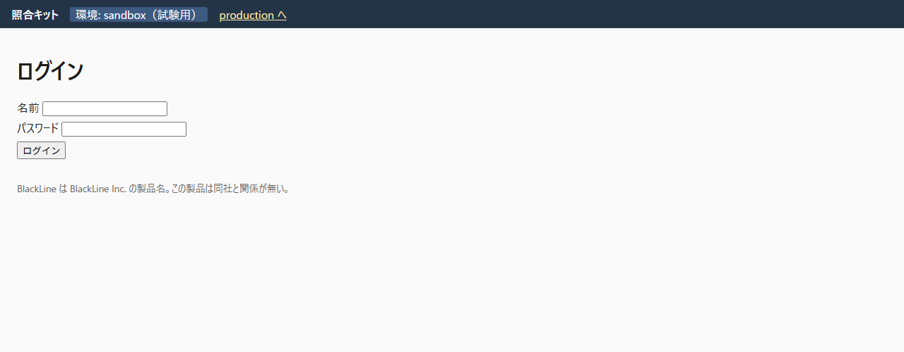
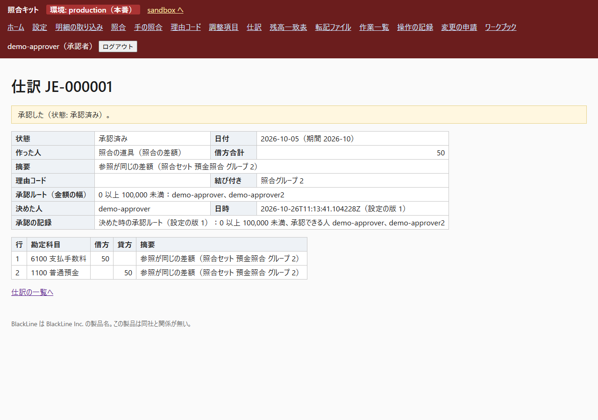
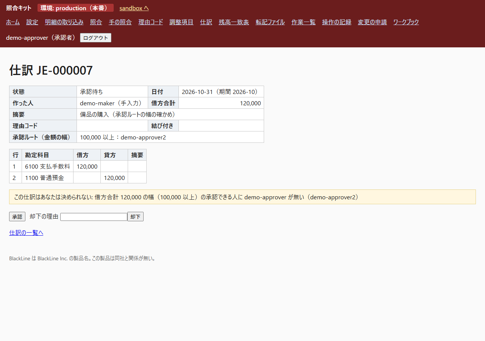

# 操作マニュアル（利用者向け）

様式の出典：CMS Technical Lifecycle Framework "User Manual" の章立て（https://www.cms.gov/Research-Statistics-Data-and-Systems/CMS-Information-Technology/TLC/Downloads/User-Manual.docx ）と、デジタル庁「デジタル社会推進実践ガイドブック DS-120 デジタル・ガバメント推進標準ガイドライン実践ガイドブック」（2024-05-31 https://www.digital.go.jp/assets/contents/node/basic_page/field_ref_resources/e2a06143-ed29-4f1d-9c31-0f06fca67afc/d85eeb55/20240605_resources_standard_guidelines_guideline_05.pdf ）の「システム操作マニュアル（利用者向け）」の説明にある「役割別に分かれる可能性がある。」という区別。出典：デジタル庁。章立てだけを使い、文は自作した。この repo に合わせて章を変えた（変更：「使い方」を役割ごとに分け、画面の項目の説明を別の節にした）。How-to の考え方（目的ごとの手順）は Diátaxis（https://diataxis.fr/ ）から、考え方だけを借りている。

この文書は、管理者向けではない画面の使い方を、役割ごとに書く。ワークブックの読み込み、変更の申請、利用者の追加は `manual-admins.md`。

## 1. はじめに

### 1.1 概要
照合キットは、月次の銀行の残高の照合と、そのまわりの決算の作業をする道具。設定のワークブック（Excel）が、データ源・照合のルール・理由コード・誰がいくらまで承認するか・作業一覧を決める。銀行の明細と帳簿の CSV を取り込み、ルールの順に照合し、きれいに合わなかった物を人に見せる。差額には理由コードを付けて、**仕訳の下書き**か**調整項目**にする。**別の人**が承認する。期末の**残高一致表**で、調整後の銀行残高と調整後の帳簿残高が合うかを見る。画面は日本語。

BlackLine は BlackLine Inc. の製品名で、この道具は同社と関係が無く、同じ製品でもない。

### 1.2 読む人
| あなたの役割 | 読む節 |
|---|---|
| 作成者 | 3.1 |
| 承認者 | 3.2 |
| 監査人 | 3.3 |
| 管理者 | `manual-admins.md`（変更の申請の「結果の承認」をする時は 3.2 の最後も） |

役割は 1 人が複数持てる。ただし、自分が作った物は自分では承認できない（どの役割をいくつ持っていても）。

## 2. 始め方

### 2.1 注意
- この道具には 2 つの環境がある。**sandbox**（試す所）と**本番（production）**。画面の上の帯に「環境: sandbox（試験用）」か「環境: production（本番）」と出る。**本番の帯が出ている時の操作は、本番の記録になる**。
- 転記ファイルは本番だけが出す。sandbox の「転記ファイル」の画面は、試験用の表示を出して止まる。
- 操作は全部、サーバーが役割と人を確かめる。画面にボタンが出ていなくても、直接送った操作は拒否され、記録に残る。
- 銀行明細や帳簿の CSV の内容は、書いてある通りに画面に出る。数式の文字（`=` `+` `-` `@` で始まる摘要）の仕訳は保存できない。

### 2.2 準備
- 管理者から、名前とパスワードをもらう（管理者が作る。自分では作れない）。
- 本番の設定の版が入るまで、本番の多くの画面は「本番の版が無い（変更の申請で上げる）」と出て止まる。管理者に聞く。

### 2.3 利用の権限
| 操作 | 作成者 | 承認者 | 管理者 | 監査人 |
|---|---|---|---|---|
| 画面を見る・CSV を出す（見る物の範囲は下の注） | ○ | ○ | ○ | ○ |
| 明細を取り込む・照合を実行する | ○ | | ○ | |
| 理由コードを付ける・仕訳を入力・取り込む・申請する | ○ | | | |
| 仕訳・調整項目・手の照合を承認する／却下する | | ○ | | |
| 作業を作成完了にする | ○ | | | |
| 作業を完了にする・差し戻す | | ○ | | |
| 転記ファイルを出す | | | ○ | |
| 変更の申請を作る・適用する | | | ○ | |
| 変更の申請の結果を承認する | | ○ | ○ | |

注：変更の申請の一覧の CSV と操作の記録の CSV は、管理者と監査人だけが出せる。表は `close_kit/roles.py` の表と同じで、試験（`tests/test_close_roles_web.py` ほか）が 1 マスずつ確かめている。

### 2.4 開き方
1. 管理者が起こしたサーバーの URL（例：`http://127.0.0.1:8765`）をブラウザで開く。
2. ログインの画面で「名前」と「パスワード」を入れて「ログイン」を押す。同じ名前で 15 分に 10 回まちがえると、一時的に入れなくなる。

図 1：ログインの画面

### 2.5 画面の並び
上に帯があり、左から「照合キット」、環境の名前（`sandbox へ`／`production へ` で切り替え）、メニュー、あなたの名前と役割、「ログアウト」。メニューは、ホーム・設定・明細の取り込み・照合・手の照合・理由コード・調整項目・仕訳・残高一致表・転記ファイル・作業一覧・操作の記録・変更の申請・ワークブック。メニューのリンクは、いま開いている環境の中へ行く。

図 2：本番のホーム

別のタブで環境を切り替えても、前から開いていたタブの操作は、そのタブの環境の物として扱われる（環境は画面の URL と、送る形式の中の両方に入っていて、サーバーが同じかを確かめる）。食い違うと「画面の環境と URL の環境が違う（画面を開き直す）」と出て、何も変わらない。

### 2.6 終わり方
右上の「ログアウト」を押す。8 時間たつとログインが切れる。

## 3. 使い方

### 3.1 作成者

#### 3.1.1 明細を取り込んで照合する
1. 「明細の取り込み」を開く。「データ源」（帳簿・銀行など）を選び、「ファイル」を選んで「取り込む」を押す。
2. 成功すると「取り込んだ（N 行）」と出る。残高が合わない銀行明細、すでに取り込んだ範囲と重なるファイルは「取り込めない（何も保存していない）」と理由が出る。
3. 「照合」を開き、照合セットを選んで「照合を実行する」を押す。区分（自動・候補・未照合・重複・手）ごとの件数が出る。区分の「明細」のリンクで行を見る。

注意：照合を実行すると、完了した組と、差額の処理待ちの組は、次の実行でも変わらない。

照合の結果の読み方：
- 許容差の中で金額が少し違う組は、規則に「差額の相手勘定」が書いてあれば、その場で「完了」になり、道具が差額の仕訳を下書きに作る（実行の後の文に件数が出る。作った人は「照合の道具」）。書いていない規則の組は「差額の処理待ち」になり、次の 3.1.2 で理由コードを付ける。
- 同じ参照の行が同じデータ源に 2 つ以上ある時（重複）も、照合に入る。画面の「重複」の欄と、グループの行の「［重複］」の印で分かる。相手が 2 つ以上ありうる組は、自動にしないで「候補」（理由 ambiguous）になる。人が「手の照合」で決める。
- 先の規則が作った「候補」の行は、後の規則は使わない。規則の順番が優先の順番になる。
- 束ねる規則（多対 1・1 対多・多対多）は、金額の許容差を使わない（合計が等しい時だけ当たる）。日付は、束ねるキーに「勘定日」がある時だけ比べる。

#### 3.1.2 差額に理由コードを付ける
1. 「理由コード」を開き、照合セットを選ぶ。
2. 「差額の処理待ちのグループ」の行で、理由コード（例：R01 振込手数料）を選んで「仕訳の下書きを作る」を押す。「未照合の行」の行では「付ける」を押す。銀行の側の行に付けられるのは処理が「仕訳」の理由コードだけ。帳簿の側の行には「調整項目」（時期のずれ。翌期へ繰り越す）も付けられる。
3. 仕訳の下書き（番号 JE-000001 など）か、調整項目ができる。調整項目は、承認者が承認してから残高一致表に入る。

#### 3.1.3 仕訳を入力する・取り込む・申請する
1. 「仕訳」を開き、「手で入力する」か「CSV で取り込む」を押す。
2. 手で入れる時は、日付（西暦 2026-10-31）、摘要、勘定コード、借方、貸方を入れて「下書きに保存する」を押す。借方と貸方が合わない、勘定表に無いコード、締めた期間の日付は保存できず、理由（規則の番号・行・値）が出る。
3. 仕訳の番号を押して詳細を開き、「申請する」を押す。承認ルートの「金額の幅」にいる承認者が決める。取り下げる時は「取り下げる」。
4. 照合で道具が作った仕訳（「作った人」が「照合の道具」、方法が「照合の差額」）は、内容を見てから、役割「作成者」の誰でも申請・取り下げができる。承認は別の人（承認者）で、道具が作った人なので、承認者は必ず作った人と別になる。却下するか取り下げると、その組は「差額の処理待ち」に戻り、3.1.2 の理由コードで直せる。

#### 3.1.4 作業を作成完了にする
「作業一覧」で会計期間を選ぶ。自分が「作成者」になっている作業で、前の作業が完了している物の行に「作成完了」のボタンが出る。完了の条件（例：残高一致の差が 0）を満たさない時は、満たさない理由が出て、作成完了にならない。

### 3.2 承認者

#### 3.2.1 仕訳を承認する
ここは受け入れの確認で、画面を見ながら通す手順になっている（`test-cases.md` の TC-18）。
1. ログインして、上の帯の環境が、承認する仕訳のある環境（本番の仕訳なら「production（本番）」）か確かめる。違えば帯の「production へ」「sandbox へ」で切り替える。
2. メニューの「仕訳」を押す。「状態」の欄で「承認待ち」を選び「絞り込む」を押す。
3. 承認する仕訳の「番号」（例：JE-000001）を押す。
4. 詳細で次を確かめる：日付と期間、借方合計、各行の勘定科目（コードの横に名前が出る）と借方・貸方、摘要、「承認ルート（金額の幅）」に自分の名前があること。
5. 「承認」を押す。画面に「承認した（状態: 承認済み）。」と出て、状態が「承認済み」、「決めた人」に自分の名前が出る。
6. 却下する時は、「却下の理由」を入れて「却下」を押す。「却下した（状態: 却下）。」と出る。
7. 承認できない時は、画面に「この仕訳はあなたは決められない: …」と理由が出る。ボタンを押しても、同じ仕訳の画面に理由がもう一度出る（サーバーは 403 を返す）だけで、何も変わらない。理由は次のどれか：自分が作った仕訳、役割「承認者」が無い、借方合計に当たる承認ルートの幅が無い、その幅の承認できる人に自分の名前が無い。

図 3：承認者の仕訳の詳細

図 4：承認した後

図 5：承認できない仕訳（承認ルートの幅の承認できる人に自分の名前が無い時）

#### 3.2.2 調整項目を承認する
「調整項目」を開く。状態が「承認待ち」の行の右の「承認」か「却下」（理由を入れる）を押す。作った人とは別の人だけが決められる。承認された物は「未解消」になり、残高一致表の「調整項目」に出る。解消するまで、作った期間以降の全部の期間の表に出る。

#### 3.2.3 手の照合を承認する
「手の照合」を開く。「承認待ちの手の照合」の表で、行の内容を見て「承認」か「却下」を押す。照合した本人は承認できない。左右の合計が合えば「完了」、合わなければ「差額の処理待ち」になる。

#### 3.2.4 作業を完了にする・差し戻す
「作業一覧」で、自分が「確認者」になっている作業が「作成完了」になったら、「完了」か「差し戻し」（「差し戻しの理由」を入れる）のボタンが出る。完了の条件を満たさないと完了にならない。完了の後で条件が崩れる取り込みがあると、その作業は「作成完了」に戻る。

#### 3.2.5 変更の申請の結果を承認する（承認者の役割）
1. 「変更の申請」を開き、番号を押す。状態が「試験済み」の申請に、「試験の結果」がある。
2. 「7 変わる部分（シートと行）」と、「試験の結果」の「1 本番のデータで前と後」（区分ごとの件数と「区分が変わった行」）、「3 変わったシートごとの効き目」（「金額（境目）」ごとの「承認できる人 前」と後）を読む。結果が「失敗（変更の影響）」の時は、どの手順で止まったかが出ている。
3. 良ければ「結果を承認」、だめなら理由を入れて「結果を却下」。申請者は、自分の申請をどの段でも承認できない。結果の承認は、承認者の役割の人 1 人と管理者の役割の人 1 人が両方そろって初めて通る。
4. 承認は、画面に出ている試験の結果（「試験の結果 N」）に対する物として記録される。画面を開いた後で試験が流し直されていると、承認は断られ、「最新ではない」と出る。画面を開き直して、新しい結果を読んでから決める。

### 3.3 監査人
- すべての画面を見られ、何も変えられない。変える操作の画面は出ず、直接送っても 403 になる。
- 「仕訳」「残高一致表」「操作の記録」「変更の申請」から CSV を出せる。操作の記録には、誰が・いつ・何を・どの環境で・どの設定の版で・結果が出る。拒否された操作も理由つきで残る。
- 「変更の申請」の詳細では、承認した人ごとに、その人の利用者を作った日が出る。申請より後に作られた利用者には印が付く。

### 3.4 画面の項目の説明
| 画面 | 見る所と意味 |
|---|---|
| 照合 | 区分：自動＝ルールで照合した。候補＝確認が要る。未照合＝相手が無い。重複＝同じ参照の行が同じデータ源に 2 つ以上ある（照合には入り、相手が見つからなかった行がこの区分に残る。相手のある行には「重複」の印が付く）。手＝手の照合 |
| 残高一致表 | 銀行の期末残高 ＋ 帳簿にあって銀行にまだ無い入金 − 同じく出金 ＝ 調整後の銀行残高。帳簿の期末残高 ± 帳簿にまだ無い銀行の動き ＝ 調整後の帳簿残高。差（原因の分からない差）が 0 なら「差 = 0。原因の分からない差は無い」。赤い数字は 0 でない差 |
| 仕訳 | 状態は 下書き・承認待ち・承認済み・却下・取り下げ。「結び付き」は元になった照合のグループか行。作った方法は 理由コード・手入力・取り込み・照合の差額（道具が下書きにした物） |
| 調整項目 | 状態は 承認待ち・未解消・解消・却下。「経過の日数」は作った期間の末日からの日数 |
| 作業一覧 | 期日は期末日からの日数（営業日・暦日・平日）で決まる。期日を過ぎた行に印が出る。「条件の結果」は完了の条件を満たしているか |
| 変更の申請 | 状態は 下書き・事前承認待ち・試験待ち・試験済み・結果の承認済み・本番に適用済み・確認済み・確認できない・却下・取り下げ |

## 4. 困った時

### 4.1 誤りの文
| 画面の文 | 意味と、すること |
|---|---|
| この操作はあなたの役割には許可されていない | その操作の役割が無い。2.3 の表を見る |
| 画面の環境と URL の環境が違う（画面を開き直す） | 古いタブから送った。ブラウザの画面を開き直す |
| 本番の版が無い（変更の申請で上げる） | 本番に設定の版がまだ無い。管理者に聞く |
| 試験用。転記ファイルは production から出す | sandbox の転記ファイルの画面。本番に切り替える |
| 取り込めない（何も保存していない） | 残高や合計が合わない、すでに取り込んだ範囲と重なる。理由の文を管理者に見せる |
| 保存・申請・承認できない: … | 仕訳の検証（借方＝貸方、2〜999 行、勘定コード、締めた期間、摘要）に通らない。文に規則と行が出る |
| この仕訳はあなたは決められない: … | 3.2.1 の 7 |
| 申請者は、自分の申請の承認・却下・適用ができない | 変更の申請を出した本人は、どの段も決められない |
| 画面の試験の結果 N は最新ではない | 画面を開いた後で試験が流し直された。画面を開き直して、最新の結果を読んでから決める |

### 4.2 特別な注意
- 転記ファイルを SAP に取り込む試験は、この道具では行っていない。見出しの文字と日付の形式は、導入先の SAP で確かめる。
- 摘要は転記ファイルの BKTXT で 25 文字に切られる（SAP のヘルプ "Adding Field Columns in Template" は BKTXT を「Document Header Text (25)」と載せ、「The number next to each field indicates the character or number limit of the value you enter.」と書く）。切られる仕訳は、転記ファイルの画面に出る。
- 銀行明細の金額は最小単位の整数で扱い、画面は桁区切りで出す。

### 4.3 問い合わせ
管理者に聞く。利用者の追加・パスワード・設定の版・変更の申請は管理者の仕事（`manual-admins.md`）。公開資料との違いで答えが要る質問は `qa-log.md`。

## 付録 A：変更の記録
| 日付 | 変更 |
|---|---|
| 2026-10-25 | 最初の版。 |
| 2026-10-25 | 3.2.1 の受け入れのケースの番号（TC-18）、3.2.4 のボタンの名前、3.2.5 の画面の見出しの名前を、実物に合わせた。結果の承認が画面の試験の結果に結ぶことを足した。 |

## 付録 B：用語集
| 語 | 意味 |
|---|---|
| 設定の版 | 管理者が読み込んだワークブックを、検査して保存した物。追記だけで、消えない |
| 環境 | sandbox（試す所）と production（本番）。それぞれが「どの設定の版を使うか」を 1 つ指す |
| 照合セット | 左と右のデータ源を組にして照合する単位 |
| パスルール | 照合のルール。上から順に当てる |
| 理由コード | 差額や未照合に付ける理由。仕訳か調整項目に結び付く |
| 調整項目 | 帳簿にあって銀行にまだ無い入金・出金。翌期へ繰り越す |
| 残高一致表 | 期末の、調整後の銀行残高と調整後の帳簿残高の比べ |
| 変更の申請 | 設定の版を本番に上げる申請。申請・事前承認・試験・結果の承認・適用・確認の順に進む |

## 付録 C：参照した文書
`docs/sources.md` と `qa-log.md`、`docs/adr/`。

## 付録 D：承認
導入先で書く（承認者の署名・日付）。

## 付録 E：画面の画像の置き場所
画像は `docs/deliverables/images/` に置く。名前と代わりの文は下のとおり（本文の中の枠と同じ）。画像は、ブラウザで通した時に撮って置く。

| ファイル名 | 代わりの文 |
|---|---|
| `01-login.png` | ログインの画面。名前とパスワードの欄と「ログイン」のボタン |
| `02-home-production.png` | 本番のホーム。上の帯に「環境: production（本番）」が出ている |
| `04-journal-detail-approver.png` | 仕訳の詳細。承認ルートと「承認」「却下」のボタン |
| `05-journal-approved.png` | 承認した後。「承認した（状態: 承認済み）。」 |
| `06-journal-not-allowed.png` | 承認者 demo-approver が、借方合計 120,000 の仕訳（承認ルートの幅 100,000 以上の承認できる人は demo-approver2 だけ）を開いた画面。「この仕訳はあなたは決められない: 借方合計 120,000 の幅（100,000 以上）の承認できる人に demo-approver が無い（demo-approver2）」の文 |
